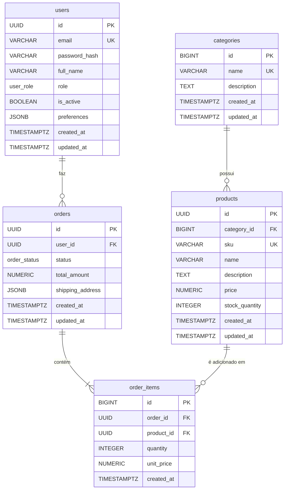

# Modelagem de Banco Relacional

Este repositório contém a modelagem e o script de criação de um banco de dados relacional para um sistema de gestão.

## Diagrama Entidade-Relacionamento

Abaixo está o diagrama ER (Entidade-Relacionamento) criado com Mermaid, representando as tabelas, colunas, chaves primárias/estrangeiras e os relacionamentos do schema definido em `schema.sql`.

